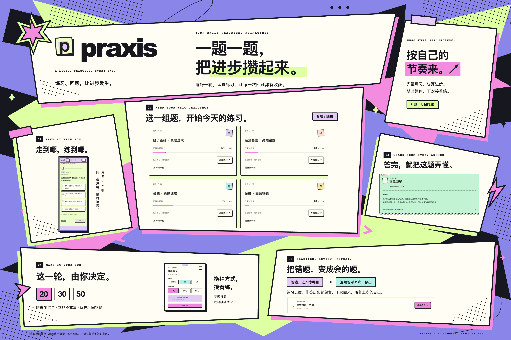
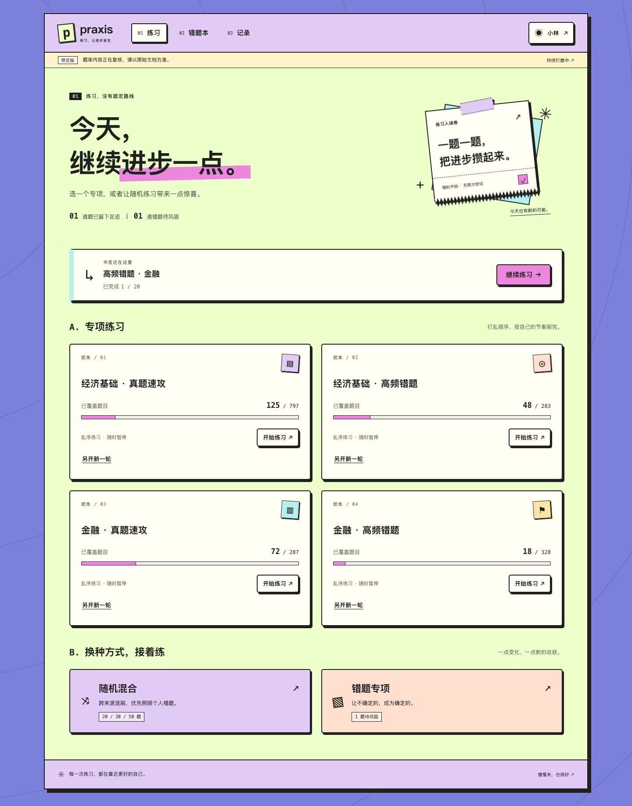
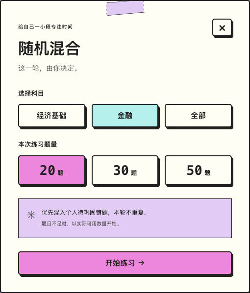
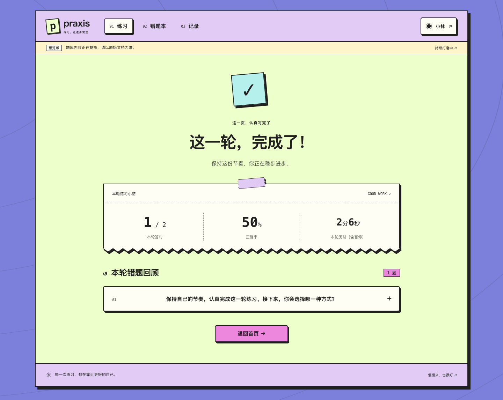
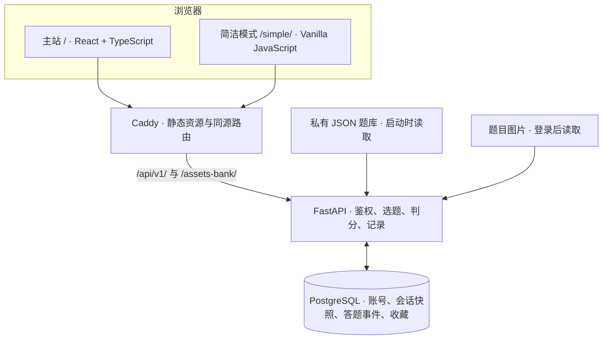

<div align="center">
  
  <h1>Praxis</h1>
  <p><strong>认真练一题，看懂每一次反馈。</strong></p>
  <p>一个可自托管的练习与复习应用。两种界面，共用题库、账号、错题和学习记录。</p>
  <p><code>MIT</code> · <code>Self-hosted</code> · <code>React + FastAPI</code> · <code>Desktop & Mobile</code></p>
  <p><a href="#项目背景">背景</a> · <a href="#功能与使用方式">功能</a> · <a href="#界面与视觉">界面</a> · <a href="#架构设计">架构</a> · <a href="#快速开始">快速开始</a> · <a href="CONTRIBUTING.md">参与贡献</a></p>
</div>



<p align="center"><a href="docs/assets/showcase/praxis-overview-kpb.png">高清海报</a> · <a href="docs/assets/showcase/overview-kpb.html">可编辑源文件</a> · <a href="docs/assets/showcase/praxis-overview.png">原版海报</a></p>

> **当前为 1.0 开发版，面向个人学习与小规模自托管。** 公开仓库提供源码、展示素材和自编演示题生成器；第三方题库与运行数据独立保存。许可范围见 [NOTICE](NOTICE.md)。

## 项目背景

题目、答案和解析经常散落在不同文档里：找到题目不难，接着上次的进度练习、回看当时的选择、判断哪些错题已经掌握，才是容易中断的部分。

Praxis 从这个日常需求出发，把一次练习整理成一个可以持续的流程：

**选题 → 作答 → 理解解析 → 回顾错题 → 再练一次。**

项目关注三个具体问题：

- **让阅读保持连贯。** 题干与选项使用稳定字号，提交后把解析放到视觉中心，检查与继续按钮保持在屏幕底部。
- **让记录可追溯。** 每轮练习保存题目内容与选项顺序，更新题库后仍能回看当时的作答。
- **让数据由自己维护。** 应用、数据库和题库可以部署在自己的服务器上，源码与实际学习资料分开管理。

## 功能与使用方式

### 两种界面，同一份进度

| 入口 | 适合的使用方式 | 界面特点 |
| --- | --- | --- |
| **Praxis 主站 · `/`** | 专注作答、阅读解析与阶段回顾 | 纸张与描边设计、两阶段答题布局、固定操作栏、有限像素反馈 |
| **Praxis · 简洁模式 · `/simple/`** | 快速刷题、背题、筛选与键盘操作 | 轻量独立页面、蓝白卡片、夜间模式、题号网格、临时查看答案 |

两者共用登录 Cookie、服务端判分、收藏和错题状态。同一浏览器的页面通过通知刷新记录，不同设备在重新加载或返回窗口时从服务端读取进度。简洁模式保留独立的展示层，数据以共用 API 为准。

### 已实现的能力

| 能力 | 行为 |
| --- | --- |
| **专项与随机练习** | 专项乱序覆盖；混合练习支持 20 / 30 / 50 题，并优先混入待巩固错题 |
| **断点续练** | 暂停后继续同一轮；新题库版本与历史会话快照分别处理 |
| **错题与收藏** | 错题连续答对两次后移入已巩固，保留累计作答和错误次数；电脑每页 12 题、手机每页 5 题 |
| **选项与解析同步** | 固定选项 ID 负责判分，显示字母按本轮顺序生成；明确的解析引用同步映射，不确定时保留原文与对照 |
| **完整材料回看** | 单选、多选、文字解析及案例图片；提交后可展开完整题目或仅回看已选与正确选项 |
| **简洁模式操作** | 单选即判、多选提交、遮盖答案、临时查看答案、题号跳转，以及题集／科目／题型等筛选 |
| **键盘与移动端** | 简洁模式支持 `A–E`、`1–5`、`Enter`、左右方向键、`S` 收藏、`R` 重做；界面响应减少动态效果偏好 |
| **账号与维护** | 独立账号、修改密码、退出登录、终端创建管理员；备份、恢复和应用镜像回滚 |
| **私有题库工作流** | PDF 候选提取、硬换行整理、JSON 校验、差异预览和发布；导入旧记录时由服务端重新判分 |

更多交互说明见 [主站答题布局](docs/practice-layout.md)、[简洁模式](docs/simple.md) 和 [解析引用与错题分页](docs/explanation-references.md)。

## 界面与视觉

主站沿用纸张、粗描边、硬阴影和紫／绿／粉色块；简洁模式采用轻量卡片布局。动作反馈与阅读过渡分开处理，避免长解析被逐字动画拖慢。

<table>
  <tr>
    <td width="58%" valign="top"><strong>从练习入口继续自己的进度</strong><br /><a href="docs/assets/showcase/home.png"></a></td>
    <td width="42%" valign="top"><strong>选择科目与本轮题量</strong><br /><a href="docs/assets/showcase/setup-card.png"></a><br /><strong>把每一轮练习留在记录里</strong><br /><a href="docs/assets/showcase/summary.png"></a></td>
  </tr>
</table>

海报与截图使用真实组件和自编演示数据，数字与姓名均为演示内容。现有素材记录了较早的视觉版本，最新回看布局、分页和简洁模式品牌以当前代码为准。原素材保留，可通过 [素材说明](docs/assets/showcase/README.md) 中的脚本重新生成；它们不代表仓库附带相同数量的考试题。

## 架构设计

Praxis 使用共用后端和两套前端入口。生产部署由 Caddy 提供静态页面并转发 API，PostgreSQL 保存账号与学习记录，题库在服务启动时从 JSON 载入。



### 技术选型

| 层 | 实现 | 用途 |
| --- | --- | --- |
| 主站 | React 19、TypeScript、Vite 6、TanStack Query、React Router、Motion | 状态查询、页面切换与答题反馈 |
| 简洁模式 | 原生 JavaScript、CSS、Web Animations API | 独立页面与较轻的交互层 |
| 共用逻辑 | `frontend/shared/`、`backend/explanation_refs.py` | 字母展示、解析引用和分页规则 |
| API 与数据 | FastAPI、Pydantic、SQLAlchemy Core、Alembic | 请求校验、授权、事务与迁移 |
| 存储 | PostgreSQL；开发时可使用 SQLite | 账号、登录会话、练习快照、答题事件、收藏 |
| 部署与测试 | Docker Compose、Caddy、pytest、Node Test Runner、Playwright | 部署、回归与浏览器用例 |

### 为什么题库更新不会覆盖历史作答

1. **身份与显示分离。** `question.id` 关联历史记录，`option.id` 用于判分，`label` 只表示当前界面的字母。
2. **会话保存快照。** 创建练习时冻结题干、选项、答案、解析与选项顺序；答题结果从这份快照产生。
3. **提交保持幂等。** 同一会话、同一题的重复提交复用已有结果，版本检查与事务避免重复计入事件。
4. **解析保留原文。** 明确的选项引用编译成稳定 ID，再按当前显示顺序呈现；公式和无法确认的引用回退原文。

设计与接口边界见 [架构说明](docs/architecture.md)。项目采用每轮 JSON 快照和答题事件聚合，当前重点是个人与小规模使用，尚未进行大规模并发压测。

## 快速开始

需要 **Python 3.12+**、已启动的 **Docker Engine / Docker Desktop 与 Compose 插件**，以及 Bash、`curl`、`openssl`。macOS、Linux 或 WSL 环境中，在公开源码目录运行：

```sh
python3 scripts/init_demo_bank.py
./deploy.sh local
```

打开 **http://localhost:8080**；简洁模式入口为 **http://localhost:8080/simple/**。注册自己的账号后即可体验。

- 初始化脚本生成 **200 道自编算术演示题**，覆盖四个题集和单／多选，不包含第三方考试资料。
- 已有 `data/questions.json` 时跳过初始化；脚本不会覆盖现有题库。
- 首次启动生成私有 `.env` 并执行数据库迁移。重启保留账号和学习记录；没有默认账号或管理员密码。

使用自己的题库时，先阅读 [本地题库说明](data/README.md) 和 [内容许可范围](NOTICE.md)，再校验结构：

```sh
python3 scripts/bank.py validate data/questions.json
```

## 部署与运维

```sh
./deploy.sh production   # 配置域名与 HTTPS
./deploy.sh update       # 先备份，再构建、迁移和健康检查
./deploy.sh backup
./deploy.sh logs
./deploy.sh stop         # 保留数据卷
```

固定 Compose 项目标识为 `praxis`，数据库默认不映射宿主端口。已有反向代理时可只绑定环回地址。管理员通过终端创建，当前不提供管理后台页面。

域名与端口、环境变量、已有部署迁移、备份恢复和回滚步骤见 [部署文档](docs/deployment.md)。对外部署应使用 HTTPS，私有配置、备份和题库资料分别保存。

## 本地开发

前端使用 **Node.js 22**，后端使用 **Python 3.12+**。无需启动 PostgreSQL 即可用 SQLite 联调。

```sh
python3 -m venv .venv
.venv/bin/pip install -r requirements-dev.txt
python3 scripts/init_demo_bank.py  # 已有题库时跳过
DATABASE_URL=sqlite:///data/app.db .venv/bin/alembic upgrade head
.venv/bin/uvicorn backend.app:app --host 127.0.0.1 --port 8000
```

另开终端启动前端：

```sh
npm ci --prefix frontend
npm run dev --prefix frontend
```

主站开发入口为 **http://localhost:5173**，简洁模式为 **http://localhost:5173/simple/**，本地 API 文档为 **http://127.0.0.1:8000/docs**。

### 质量检查

```sh
.venv/bin/python -m pytest -q
npm run test:presentation --prefix frontend
npm run build --prefix frontend
python3 scripts/check_docs.py
python3 scripts/check_secrets.py
python3 scripts/check_publication.py
```

[CI](.github/workflows/ci.yml) 使用自编题库执行后端、共享前端逻辑、生产构建、文档及公开内容检查，不需要服务器密钥或真实用户数据。浏览器用例单独运行：

```sh
BASE_URL=http://localhost:8080 npm run test:e2e --prefix frontend
```

默认使用已安装的 Google Chrome。浏览器安装、运行前提与截图方式见 [贡献指南](CONTRIBUTING.md)。自动化测试不能代替真实设备上的阅读与动效体验检查。

## 题库与公开发布

```text
有权使用的资料 → 候选提取 → 人工复核 → 结构校验 → 差异预览 → 发布
```

题库文本整理、选项引用审计及发布命令见 [题库说明](data/README.md)。题意、答案、法规时效与复杂公式仍需人工复核。当前分类配置面向经济基础与金融四个题集，扩展分类时需同步修改后端配置、前端筛选和测试。

**公开仓库不携带第三方 PDF、提取题库、原页图片、账号数据或实例密钥。** 若本地旧历史曾跟踪这些资料，新增 `.gitignore` 并不能移除历史对象；公开发布请使用 [独立源码副本流程](docs/github-publication.md)，保留原工作目录与素材。

## 项目结构

```text
backend/             鉴权、选题、判分、题库文本与迁移
frontend/
  src/               主站 React 界面
  simple/            简洁模式独立页面
  shared/            两站共用的展示规则
  e2e/               Playwright 场景
  tests/             共享逻辑测试与自编展示数据
scripts/             题库、运维、文档及公开内容检查
tests/               API、数据一致性和隐私回归
docs/                架构、交互、运维、截图与海报
data/                本地运行资料；默认不进入 Git
.github/             CI、Issue 与 PR 模板
```

## 参与贡献

欢迎从可复现的问题、小范围修复、体验改进和文档补充开始。请阅读 [贡献指南](CONTRIBUTING.md)，使用自编数据提供复现步骤与截图，并在 PR 中说明行为变化和验证结果。

安全问题按 [SECURITY](SECURITY.md) 的方式报告。近期变更见 [CHANGELOG](CHANGELOG.md)。

后续重点是改善大题库查询与记录加载、提高公式和材料复核的可操作性，并持续验证桌面与手机体验。管理后台、任意分类配置和大规模部署仍属于后续工作。

## 许可

原创源码采用 [MIT License](LICENSE)。第三方依赖与题库资料遵循各自许可；展示截图使用自编数据，海报及其可编辑源文件随项目保留。完整说明见 [NOTICE](NOTICE.md)。
